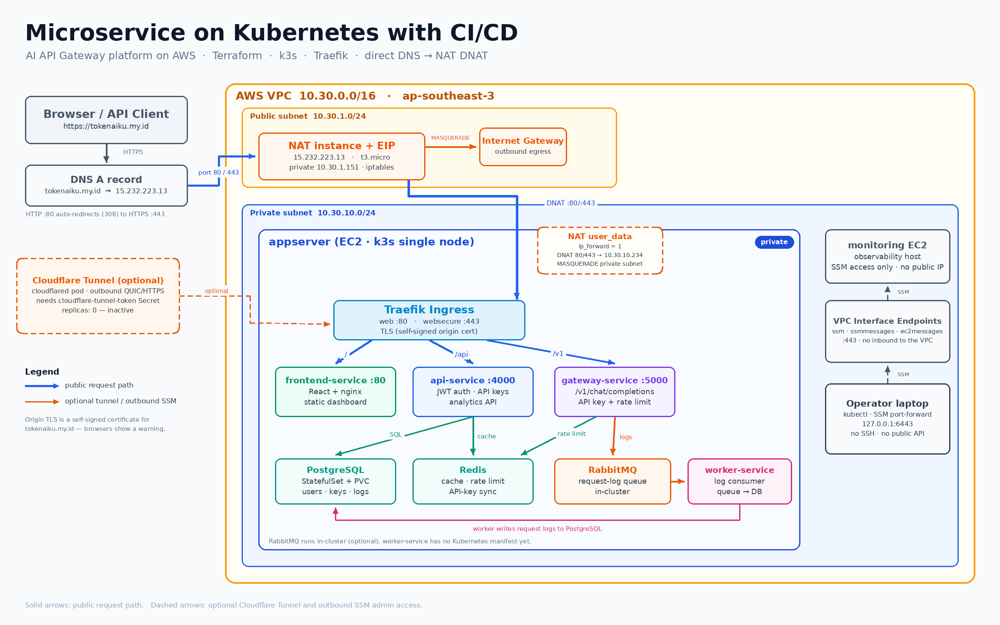

# Microservice on Kubernetes with CI/CD

This is a personal DevOps project built as part of my university coursework. It demonstrates a microservice-based AI API gateway platform deployed to a single-node k3s cluster on AWS, provisioned with Terraform and served at **https://tokenaiku.my.id**.

Public traffic takes the direct path: a DNS `A` record points to the Elastic IP of a NAT instance in the public subnet, and that instance uses `iptables` DNAT (configured from Terraform `user_data`) to forward ports 80/443 to the private appserver running Traefik. Cloudflare Tunnel is available as an optional alternative and is currently disabled.

## Project Overview

- **Infrastructure as Code (IaC):** Terraform provisions a custom VPC (`10.30.0.0/16`) with a public subnet for a NAT instance and a private subnet for the appserver and monitoring host. It also creates security groups, an Internet Gateway, VPC interface endpoints for AWS Systems Manager (SSM), and an IAM instance profile so the instances can be reached without opening SSH or the Kubernetes API to the internet.

- **Application:** An AI API gateway platform with four services:
  - `frontend-service` — React + Vite dashboard served by nginx (login, dashboard, API keys, logs, playground, docs).
  - `api-service` — Express + Prisma API for JWT authentication, API key management, and analytics.
  - `gateway-service` — OpenAI-compatible `/v1/chat/completions` endpoint with API-key validation and Redis-backed rate limiting.
  - `worker-service` — RabbitMQ consumer that stores request logs in PostgreSQL.
  - Data layer: PostgreSQL (StatefulSet + PVC), Redis, and RabbitMQ.

- **Deployment:** Kubernetes manifests in `kubernetes/` run the platform in the `microservice-app` namespace with health probes and resource limits. Traefik (bundled with k3s) routes `/`, `/api`, and `/v1` and terminates TLS on the single node. The node has no public IP: the NAT instance receives public HTTP/HTTPS and forwards it to Traefik. An optional `cloudflared` Deployment can expose the same app outbound-only through Cloudflare.

- **CI/CD:** Each service has its own Dockerfile. Images are published to Docker Hub as `wiraaja1/microservice-on-kube-with-cicd-*`, and the cluster is updated by applying the manifests in `kubernetes/`. The build, push, and deploy steps are currently run manually and can be automated with GitLab CI or GitHub Actions.

- **Security:** Private subnets, no SSH or Kubernetes API inbound rules, SSM Session Manager for admin access, Kubernetes Secrets for database/JWT/TLS credentials, API-key authentication, and Redis-based rate limiting. The origin certificate is self-signed for `tokenaiku.my.id`; a trusted certificate (Let's Encrypt or a Cloudflare Origin Certificate) is the next step.

- **Monitoring:** Terraform provisions a separate monitoring EC2 instance in the private subnet, reachable only through SSM. A full Prometheus/Grafana stack is not included in this repository yet.

## Pipeline Architecture



#### Infrastructure (AWS with Terraform)

- Custom VPC `10.30.0.0/16` with public subnet `10.30.1.0/24` and private subnet `10.30.10.0/24`.
- NAT instance (t3.micro, private IP `10.30.1.151`) with an Elastic IP (`15.232.223.13`). It provides outbound internet access for the private subnet (image pulls, package installs) and forwards inbound public traffic to the appserver.
- The NAT instance is configured by Terraform `user_data`, which:
  - enables `net.ipv4.ip_forward` permanently (`/etc/sysctl.d/99-nat-forward.conf`);
  - keeps `POSTROUTING MASQUERADE` for `10.30.10.0/24` so the private subnet can reach the internet;
  - adds `PREROUTING` DNAT rules for TCP `:80` and `:443` to `10.30.10.234:80/443` (the appserver). The rules are scoped with `! -s 10.30.0.0/16`, so outbound HTTP/HTTPS from the node itself is not redirected back to Traefik;
  - adds matching `FORWARD ACCEPT` rules and persists everything with `netfilter-persistent save`.
- Because `user_data` only runs on first boot, the same script is applied to the running instance through SSM when the rules need to change or be repaired.
- `appserver` (k3s) at `10.30.10.234` and `monitoring` EC2 instances live in the private subnet with no public IP.
- Security groups allow `:80`/`:443` to the NAT instance and from the NAT instance to the appserver only; there is no SSH or Kubernetes API inbound rule.
- SSM interface endpoints (`ssm`, `ssmmessages`, `ec2messages`) plus an IAM instance profile allow admin access through SSM port forwarding. No bastion and no SSH port are used.
- Terraform configuration lives in `terraform/`; reusable VPC and instance modules are kept under `terraform/modules/`.

#### Application Deployment (Kubernetes)

- Namespace: `microservice-app`.
- Deployments: `frontend`, `api-service`, `gateway-service`, plus `redis` and `rabbitmq`.
- PostgreSQL runs as a StatefulSet with a PersistentVolumeClaim.
- Services are `ClusterIP`; Traefik Ingress exposes three paths:

  | Path | Backend |
  |---|---|
  | `/` | `frontend-service:80` |
  | `/api` | `apiservice-service:4000` |
  | `/v1` | `gatewayservice-service:5000` |

- Readiness, liveness, and startup probes are configured for the API service; Redis and RabbitMQ also have health probes.
- `cloudflared` runs in the `cloudflare-tunnel` namespace and is **optional**: it connects outbound to Cloudflare and forwards `tokenaiku.my.id` to Traefik. The Deployment is scaled to `0` because the public path uses DNS + NAT DNAT instead, and it needs a `cloudflare-tunnel-token` Secret before it can start.
- TLS for the three Ingresses uses `tls.crt` / `tls.key` from `apiservice-secret`. The current pair is self-signed for `tokenaiku.my.id` and `www.tokenaiku.my.id`, so browsers show a certificate warning until a trusted certificate is installed.

#### Request Flow

1. Browser or API client resolves `tokenaiku.my.id` (DNS `A` record) to the NAT Elastic IP `15.232.223.13`.
2. The NAT instance DNATs TCP `:80`/`:443` to the appserver at `10.30.10.234`, where Traefik accepts the connection. Port 80 is answered with a `308` redirect to HTTPS.
3. Traefik terminates TLS and routes `/` to the frontend, `/api` to `api-service`, and `/v1` to `gateway-service`.
4. `api-service` reads and writes users, API keys, and analytics data in PostgreSQL, and syncs API keys to Redis.
5. `gateway-service` validates the `x-api-key` header against Redis and applies a per-key rate limit.
6. `gateway-service` can publish request logs to RabbitMQ; the optional `worker-service` consumes them and writes them to PostgreSQL.

> Optional path: with a tunnel token, `cloudflared` connects outbound to Cloudflare and forwards the same hostname to `traefik.kube-system.svc.cluster.local:443`, so no inbound NAT rule is required.

#### CI/CD Pipeline

- Build each service image from `apps/<service>/Dockerfile`.
- Tag and push the images to Docker Hub.
- Apply the manifests in order: namespace, secrets, database, Redis, RabbitMQ, API service, gateway service, frontend, ingress, and (optionally) Cloudflare Tunnel.
- Roll back a deployment with `kubectl rollout undo deployment/<name> -n microservice-app`.
- The steps above are currently run manually; they can be moved into GitLab CI or GitHub Actions later.

#### Security (DevSecOps)

- Network isolation: the appserver and monitoring host have no public IP. Only the NAT instance is internet-facing, and it forwards just TCP `:80`/`:443` to the appserver. Outbound traffic from the node is masqueraded and deliberately excluded from the DNAT rules.
- Admin access through AWS SSM Session Manager and IAM; no SSH key or public Kubernetes API endpoint is exposed.
- Secrets are kept in Kubernetes Secrets and out of Git. `.gitignore` covers `kubernetes/**/*-secret.yaml`, `*.kubeconfig`, `terraform.tfstate`, `terraform.tfvars`, and `.env` files.
- Application security: bcrypt password hashing, JWT authentication, API-key validation, and rate limiting.
- Future improvement: add SAST, dependency scanning, and container image scanning (for example SonarQube and Trivy) to the pipeline.

#### Monitoring

- A dedicated monitoring EC2 instance is provisioned by Terraform in the private subnet.
- It is reachable only through SSM Session Manager.
- Kubernetes probes provide basic health checks, and logs are available with `kubectl logs`.
- A Prometheus/Grafana stack can be added later on the monitoring host.

## Getting Started

### 1. Prerequisites

- AWS account with billing enabled and permissions to create VPC, EC2, and IAM resources.
- Terraform, AWS CLI, `kubectl`, Docker, and Node.js 22+ installed.
- AWS Session Manager plugin installed for SSM port forwarding.
- A domain whose DNS you control (this project uses `tokenaiku.my.id`).
- Optional: a Cloudflare account with a tunnel token if you want to use the outbound-only tunnel instead of the NAT path.
- A Docker Hub account, or update the image names in `kubernetes/` to your own registry.

### 2. Set Up Infrastructure

Create `terraform/terraform.tfvars` (not committed) with your own values:

```hcl
aws_region      = "ap-southeast-3"
public_ip_local = "YOUR_PUBLIC_IP/32"
key_name        = "YOUR_KEY_PAIR"
instance_type   = "t3.small"
```

Then provision the infrastructure:

```bash
cd terraform
terraform init
terraform apply
```

Terraform outputs the VPC, subnet, instance IDs, private IPs, and security group IDs.

### 3. Deploy the Application

Access the k3s API through SSM port forwarding first. The full walkthrough is in [`docs/akses-kubectl.md`](./docs/akses-kubectl.md).

```bash
aws ssm start-session --region ap-southeast-3 \
  --target <appserver-instance-id> \
  --document-name AWS-StartPortForwardingSession \
  --parameters '{"portNumber":["6443"],"localPortNumber":["6443"]}'
```

In another terminal:

```bash
export KUBECONFIG=~/.kube/config-microservice
kubectl apply -f kubernetes/namespace.yml
```

Create the required Secrets manually (these files are intentionally not committed):

```bash
kubectl -n microservice-app create secret generic postgres-secret \
  --from-literal=POSTGRES_USER=postgres \
  --from-literal=POSTGRES_PASSWORD='change-me' \
  --from-literal=POSTGRES_DB=saasdb

kubectl -n microservice-app create secret generic apiservice-secret \
  --from-literal=JWT_SECRET='change-me' \
  --from-literal=POSTGRES_USER=postgres \
  --from-literal=POSTGRES_PASSWORD='change-me' \
  --from-literal=POSTGRES_DB=saasdb \
  --from-file=tls.crt=./tls.crt \
  --from-file=tls.key=./tls.key

kubectl -n microservice-app create secret generic gatewayservice-secret \
  --from-literal=RABBITMQ_DEFAULT_USER=guest \
  --from-literal=RABBITMQ_DEFAULT_PASS=guest
```

> The ingress references `tls.crt` and `tls.key` in `apiservice-secret`, and the certificate must be valid for `tokenaiku.my.id`. A self-signed pair works for the origin but browsers will warn. To generate one:
>
> ```bash
> openssl req -x509 -nodes -newkey rsa:2048 -days 365 \
>   -keyout tls.key -out tls.crt \
>   -subj "/CN=tokenaiku.my.id" \
>   -addext "subjectAltName=DNS:tokenaiku.my.id,DNS:www.tokenaiku.my.id"
> ```
>
> For a warning-free setup, replace it with a Let's Encrypt (certbot) or Cloudflare Origin certificate for the same hostname.

Deploy the workloads:

```bash
kubectl apply -f kubernetes/database
kubectl apply -f kubernetes/redis
kubectl apply -f kubernetes/rabbitmq
kubectl apply -f kubernetes/api-service
kubectl apply -f kubernetes/gateway-service
kubectl apply -f kubernetes/frontend
kubectl apply -f kubernetes/ingress
```

Check the result:

```bash
kubectl -n microservice-app get pods,svc,ingress
kubectl -n microservice-app rollout status deployment/apiservice-deployment
```

On first run, apply the Prisma migrations in `apps/api-service/prisma/migrations` against PostgreSQL (for example with `npx prisma migrate deploy` from a machine that can reach the database).

`worker-service` is implemented under `apps/worker-service` but does not have a Kubernetes manifest yet. It and RabbitMQ are optional on the 2 GB node.

### 4. Expose the Application (DNS + NAT, or Cloudflare Tunnel)

#### Primary: DNS to the NAT Elastic IP

```bash
terraform -chdir=terraform output
```

Create an `A` record for `tokenaiku.my.id` pointing at the NAT Elastic IP (for this deployment `15.232.223.13`). The NAT `user_data` already forwards `:80`/`:443` to the appserver, so no extra port-forwarding is needed. Verify:

```bash
curl -I http://tokenaiku.my.id          # 308 -> https://tokenaiku.my.id/
curl -kI https://tokenaiku.my.id        # 200 from nginx (self-signed cert)
curl -k https://tokenaiku.my.id/v1/chat/completions \
  -H 'Content-Type: application/json' \
  -d '{"messages":[{"role":"user","content":"hi"}]}'   # {"error":"API key required ..."}
```

If a DNAT rule needs to be repaired on a running NAT instance (Terraform `user_data` only runs at first boot), connect with `aws ssm start-session --target <nat-instance-id>` and re-run the `iptables`/`sysctl` block from `terraform/main.tf`.

#### Optional: Cloudflare Tunnel

The tunnel gives an outbound-only path and manages public TLS at Cloudflare's edge. It is not required for the DNS + NAT path above. To enable it:

1. Create a tunnel in Cloudflare Zero Trust and store the token as a Secret:

   ```bash
   kubectl apply -f kubernetes/cloudflare-tunnel/namespace.yaml

   kubectl -n cloudflare-tunnel create secret generic cloudflare-tunnel-token \
     --from-literal=token='PASTE_TOKEN_HERE'
   ```

2. Set `replicas: 1` in `kubernetes/cloudflare-tunnel/deployment.yaml` and apply it:

   ```bash
   kubectl apply -f kubernetes/cloudflare-tunnel/deployment.yaml
   ```

3. In the Cloudflare dashboard, add a public hostname:

   | Field | Value |
   |---|---|
   | Hostname | `tokenaiku.my.id` |
   | Service | `https://traefik.kube-system.svc.cluster.local:443` |
   | TLS → No TLS Verify | On |
   | SSL/TLS mode | Full |

4. If both paths are enabled, either point DNS at the tunnel (Cloudflare-proxied `CNAME`) or keep the `A` record to the Elastic IP — do not rely on both at once.

The complete tunnel walkthrough is in [`docs/Arsitektur CloudFlare Tunnel.md`](./docs/Arsitektur%20CloudFlare%20Tunnel.md).

### 5. Run Locally with Docker Compose

For local development, the whole stack can run without Kubernetes:

```bash
docker compose up --build
```

Create the `.env` files under `apps/` first (use the provided `.env.example` files where available).

| Service | URL |
|---|---|
| Frontend | http://localhost:3000 |
| API service | http://localhost:4000 |
| Gateway service | http://localhost:5000 |
| RabbitMQ management | http://localhost:15672 |

### 6. Monitoring

The monitoring EC2 instance is created by Terraform and has no public IP. Connect to it through SSM Session Manager. Prometheus and Grafana can be installed on this host when needed.

## Documentation

- [`docs/arsitektur.md`](./docs/arsitektur.md) — infrastructure, ingress, and Cloudflare Tunnel diagrams.
- [`docs/Arsitektur CloudFlare Tunnel.md`](./docs/Arsitektur%20CloudFlare%20Tunnel.md) — step-by-step tunnel setup.
- [`docs/akses-kubectl.md`](./docs/akses-kubectl.md) — kubectl access from a laptop through SSM.
