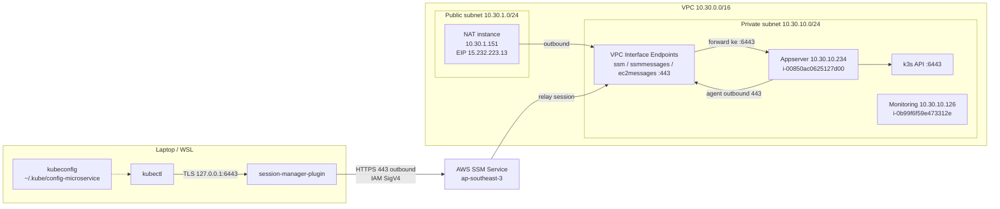
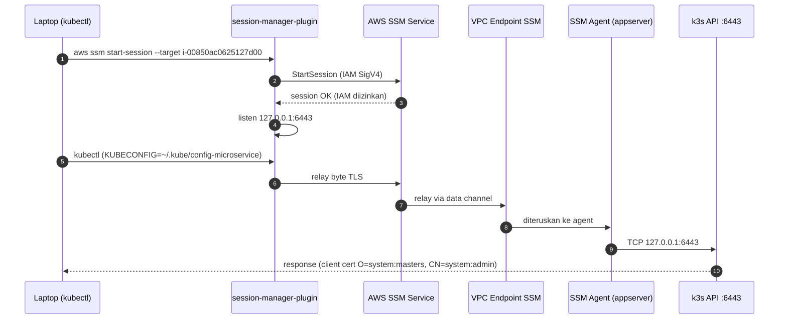

# Skema Akses kubectl ke k3s (Private Subnet)

Dokumen ini menjelaskan jalur akses `kubectl` dari laptop ke cluster k3s di
appserver **tanpa membuka SSH** dan **tanpa mengekspos API k3s ke internet**.

- Instance : `i-00850ac0625127d00` (appserver)
- Private IP: `10.30.10.234`
- k3s API  : `:6443`
- Metode   : **AWS SSM Port Forwarding**
- Kubeconfig: `~/.kube/config-microservice`
- Wrapper   : `kubectl-ms` (auto-buka tunnel + keepalive)

> Catatan: tunnel SSM punya **idle timeout default 20 menit**. Karena itu
> gunakan `kubectl-ms`, atau jalankan keepalive — lihat bagian
> [Troubleshooting](#9-troubleshooting-tadi-bisa-sekarang-connection-refused).

---

## 1. Diagram Arsitektur

```
                         LAPTOP / WSL  (180.247.240.70)
 ┌─────────────────────────────────────────────────────────────────┐
 │  kubectl  ──────────────►  https://127.0.0.1:6443               │
 │     │                                                           │
 │     └─ kubeconfig: ~/.kube/config-microservice                  │
 │        client cert: O=system:masters, CN=system:admin           │
 │                                                                 │
 │  session-manager-plugin  ◄── aws ssm start-session              │
 └───────────────────────────────┬─────────────────────────────────┘
                                 │
                                 │ outbound HTTPS 443
                                 │ (IAM SigV4, bukan SSH)
                                 ▼
 ┌─────────────────────────────────────────────────────────────────┐
 │                AWS SSM Service  (ap-southeast-3)                │
 │         validasi IAM  →  relay data channel ke agent            │
 └───────────────────────────────┬─────────────────────────────────┘
                                 │
                                 │ agent-initiated outbound 443
                                 ▼
 ╔═════════════════════════════════════════════════════════════════╗
 ║                        VPC 10.30.0.0/16                         ║
 ║                                                                 ║
 ║  PUBLIC SUBNET 10.30.1.0/24        PRIVATE SUBNET 10.30.10.0/24 ║
 ║  ┌─────────────────────────┐       ┌───────────────────────────┐║
 ║  │ IGW                     │       │ appserver 10.30.10.234    │║
 ║  └────────────▲────────────┘       │ i-00850ac0625127d00       │║
 ║               │                    │                           │║
 ║  ┌────────────┴────────────┐       │  SSM agent ──► k3s :6443  │║
 ║  │ NAT instance            │       │  kubelet    :10250        │║
 ║  │ 10.30.1.151             │       └─────────────▲─────────────┘║
 ║  │ EIP 15.232.223.13 (out) │                     │              ║
 ║  └─────────────────────────┘                     │ agent        ║
 ║                                                  │ outbound 443 ║
 ║                                  ┌─────────────┴─────────────┐║
 ║                                  │ VPC Interface Endpoints   │║
 ║                                  │ ssm • ssmmessages         │║
 ║                                  │ ec2messages   (:443)      │║
 ║                                  └───────────────────────────┘║
 ║                                                                 ║
 ║                                  ┌───────────────────────────┐  ║
 ║                                  │ monitoring 10.30.10.126   │  ║
 ║                                  │ i-0b99f6f59e473312e       │  ║
 ║                                  └───────────────────────────┘  ║
 ╚═════════════════════════════════════════════════════════════════╝

 Keterangan:
   ──►  jalur data akses kubectl (SSM session / port forwarding)
   Bastion / web proxy : TIDAK ADA (dihapus untuk penghematan biaya)
   SSH port 22 : TIDAK dipakai dan TIDAK dibuka di SG mana pun
   Ingress internet ke appserver : TIDAK ADA
```

### Mermaid (arsitektur)



---

## 2. Sequence Diagram



---

## 3. Alur Singkat

1. Laptop menjalankan `aws ssm start-session` dengan target instance appserver.
2. AWS memvalidasi IAM user (`ssm:StartSession`), lalu membuka session ke SSM agent.
3. `session-manager-plugin` membuka listener lokal `127.0.0.1:6443`.
4. `kubectl` membaca kubeconfig dan connect ke `https://127.0.0.1:6443`.
5. Trafik TLS diteruskan: plugin → AWS SSM → VPC endpoint → SSM agent → k3s `:6443`.
6. k3s memverifikasi **client certificate** dari kubeconfig (bukan token).
7. `kubectl` mendapat akses cluster sebagai `system:admin`.

---

## 4. Komponen & Port

| Komponen | Alamat | Port | Arah |
|---|---|---|---|
| kubectl → plugin | `127.0.0.1` | `6443` | lokal |
| plugin → AWS SSM | `ssm.ap-southeast-3.amazonaws.com` | `443` | outbound |
| SSM agent → endpoint | VPC interface endpoint | `443` | outbound |
| SSM agent → k3s | `127.0.0.1` / `10.30.10.234` | `6443` | lokal di appserver |
| k3s API | appserver | `6443` | hanya dari dalam VPC / session SSM |
| kubelet | appserver | `10250` | internal cluster |

**Security group yang diubah: tidak ada.**

---

## 5. Dua Lapisan Autentikasi

| Lapisan | Mengontrol | Dipakai oleh |
|---|---|---|
| **IAM** (`ssm:StartSession`) | siapa yang boleh membuka tunnel ke instance | AWS CLI / laptop |
| **k3s client certificate** | siapa yang boleh mengakses Kubernetes API dan dengan hak apa | kubectl |

Detail cert kubeconfig:

```
subject = O=system:masters, CN=system:admin
issuer  = CN=k3s-client-ca@1793638007
valid   = 2 Nov 2026 – 2 Nov 2027
```

> Token k3s (`/var/lib/rancher/k3s/server/token`) **bukan** untuk kubectl.
> Token itu dipakai untuk join node/agent. kubectl memakai kubeconfig.

---

## 6. Kenapa Bukan SSH / Bukan Buka 6443 ke Internet

| Opsi | Perubahan | Risiko |
|---|---|---|
| **SSM port forwarding** (dipakai) | tidak ada | rendah; IAM + CloudTrail, tanpa inbound |
| SSH langsung ke instance | butuh public IP + buka port 22 | menambah permukaan serangan; butuh key |
| DNAT NAT instance → `:6443` | buka port 6443 publik | API k3s terekspos internet |

Membuka `6443` di SG `aws_sg_app` saja **tidak cukup**, karena appserver tidak
punya public IP dan tidak punya jalur masuk dari internet (NAT hanya outbound).

---

## 7. Perintah Operasional

### Cara cepat: wrapper `kubectl-ms`

Script ada di `~/.local/bin/kubectl-ms` (sudah ada di `PATH`). Script ini:

- cek tunnel `127.0.0.1:6443` hidup & sehat
- kalau mati, buka tunnel SSM otomatis
- menjalankan keepalive tiap 4 menit agar tidak kena idle timeout
- menjalankan `kubectl` dengan `KUBECONFIG=~/.kube/config-microservice`

```bash
kubectl-ms get nodes
kubectl-ms get pods -A
kubectl-ms apply -f kubernetes/namespace.yml
kubectl-ms --status    # cek tunnel + keepalive
kubectl-ms --restart   # paksa buka ulang tunnel
kubectl-ms --stop      # matikan tunnel + keepalive
```

### Cara manual

Terminal 1 — buka tunnel:

```bash
aws ssm start-session --region ap-southeast-3 \
  --target i-00850ac0625127d00 \
  --document-name AWS-StartPortForwardingSession \
  --parameters '{"portNumber":["6443"],"localPortNumber":["6443"]}'
```

Terminal 2 — pakai kubectl:

```bash
export KUBECONFIG=~/.kube/config-microservice
kubectl get nodes
kubectl get pods -A
```

Cek tunnel aktif:

```bash
ss -tlnp | grep 127.0.0.1:6443
curl -sk https://127.0.0.1:6443/healthz
```

Stop tunnel: `Ctrl+C` di Terminal 1.

---

## 8. Catatan Keamanan

- `~/.kube/config-microservice` berisi **client certificate admin cluster**
  (`system:masters`). Jangan di-commit ke git dan jangan dibagikan.
- Tunnel hanya listen di `127.0.0.1`, bukan `0.0.0.0`, jadi tidak bisa diakses
  dari jaringan lain.
- Akses tunnel bisa dibatasi lebih ketat lewat IAM policy (mis. hanya user
  tertentu, hanya instance tertentu, atau wajib MFA).
- Semua pembukaan session tercatat di **CloudTrail**.
- Jika kubeconfig bocor: hapus/rotate client cert k3s atau regenerate
  `/etc/rancher/k3s/k3s.yaml`, lalu ambil ulang.

---

## 9. Troubleshooting: tadi bisa, sekarang `connection refused`

Gejala:

```
The connection to the server 127.0.0.1:6443 was refused
```

Penyebab paling umum: **SSM IdleSessionTimeout**. Session port forwarding
ditutup AWS kalau tidak ada trafik. Default-nya **20 menit**, dan saat ini
belum diubah (masih default). Di log tunnel terlihat:

```
Your session timed out due to inactivity and has been terminated.
```

Urutan cek:

```bash
# 1. tunnel lokal hidup?
kubectl-ms --status
ss -tlnp | grep 127.0.0.1:6443

# 2. instance & SSM agent hidup?
aws ec2 describe-instances --region ap-southeast-3 \
  --instance-ids i-00850ac0625127d00 \
  --query 'Reservations[].Instances[].{State:State.Name,Launch:LaunchTime}'

aws ssm describe-instance-information --region ap-southeast-3 \
  --filters 'Key=InstanceIds,Values=i-00850ac0625127d00' \
  --query 'InstanceInformationList[].[InstanceId,PingStatus,LastPingDateTime]'

# 3. k3s hidup di server? (via SSM Run Command)
#    systemctl is-active k3s && ss -tln | grep 6443

# 4. buka ulang tunnel
kubectl-ms --restart
kubectl-ms get nodes
```

| Gejala | Penyebab | Solusi |
|---|---|---|
| `connection refused` | tunnel mati (idle timeout) | `kubectl-ms get nodes` |
| tunnel mati terus | appserver stopped / SSM agent offline | start instance, tunggu SSM `Online` |
| port listen tapi timeout | k3s mati / belum siap | cek `systemctl status k3s` via SSM |
| `Unauthorized` | kubeconfig salah / cert expired | ambil ulang `/etc/rancher/k3s/k3s.yaml` |
| `no such host` / IP lain | pakai kubeconfig Rancher/lain | cek `kubectl config get-contexts` |

### Keepalive

`kubectl-ms` otomatis mengirim request ke `https://127.0.0.1:6443/healthz`
tiap **4 menit** selama tunnel hidup, sehingga session tidak dianggap idle.

Kalau mau menaikkan batas idle di sisi AWS (maks 60 menit):

```bash
aws ssm update-service-setting --region ap-southeast-3 \
  --setting-id arn:aws:ssm:ap-southeast-3:772621378316:servicesetting/ssm/session-manager/IdleSessionTimeout \
  --setting-value 60
```

Cek nilainya:

```bash
aws ssm get-service-setting --region ap-southeast-3 \
  --setting-id arn:aws:ssm:ap-southeast-3:772621378316:servicesetting/ssm/session-manager/IdleSessionTimeout
```

> Kalau `ServiceSettingNotFound`, artinya masih memakai default 20 menit.
> Bisa juga diubah lewat Console AWS → Systems Manager → Session Manager →
> Preferences → Idle session timeout.

---

## 10. Soal "kubeconfig dari Rancher"

Cluster ini adalah **k3s v1.36.5+k3s1** (distribusi dari Rancher), tetapi
**tidak ada Rancher server** yang terpasang. Buktinya tidak ada namespace
`cattle-system`:

```bash
kubectl-ms get ns
# default, kube-node-lease, kube-public, kube-system, microservice-app
```

Artinya:

| Sumber kubeconfig | `server:` | Keterangan |
|---|---|---|
| **k3s lokal** (yang dipakai) | `https://127.0.0.1:6443` | benar untuk tunnel SSM ini |
| Rancher UI (jika cluster di-import) | `https://<rancher-host>/k8s/clusters/c-xxxxx` | butuh akses ke Rancher, bukan tunnel ini |
| Rancher Desktop | `https://127.0.0.1:<port-lain>` | cluster lokal di laptop, bukan appserver |

Kubeconfig yang benar untuk appserver adalah
`/etc/rancher/k3s/k3s.yaml` (sudah disalin ke
`~/.kube/config-microservice`), bukan kubeconfig dari Rancher UI/Rancher
Desktop.

Cek konteks yang sedang dipakai:

```bash
kubectl config get-contexts
kubectl config view --minify -o jsonpath='{.clusters[0].cluster.server}{"\n"}'
```

Kalau `server:` bukan `https://127.0.0.1:6443`, berarti sedang memakai
kubeconfig lain. Pakai yang benar:

```bash
export KUBECONFIG=~/.kube/config-microservice
```

---

## 11. Best Practice Akses Manual (sebelum GitOps)

Selama belum ada GitOps/CI-CD yang men-deploy ke cluster, akses operator
manual tetap diperlukan. Supaya tetap aman dan terkontrol:

### Akses

- **Jangan buka SSH (22) atau API k3s (6443) ke internet.** Gunakan SSM
  port forwarding seperti di dokumen ini.
- **Jangan expose API lewat NAT instance publik.** Kalau benar-benar perlu,
  batasi source IP dan tetap pakai TLS + autentikasi.
- **IAM least privilege**: user yang boleh `ssm:StartSession` ke appserver
  saja, idealnya dengan MFA. Pisahkan user operator dan user CI/CD.
- **RBAC**: jangan semua orang memakai kubeconfig `system:masters`. Untuk
  operator sehari-hari, buat ServiceAccount + Role/RoleBinding terbatas
  (mis. hanya namespace `microservice-app`).
- **Audit**: aktifkan CloudTrail (sudah) dan audit log Kubernetes. Simpan
  kubeconfig admin di tempat aman, permission `0600`, jangan masuk git.
- **Rotasi**: kalau kubeconfig bocor, regenerate
  `/etc/rancher/k3s/k3s.yaml` dan ambil ulang.

### Perubahan

- Selalu **apply dari file di repo**, bukan `kubectl edit` / `kubectl patch`
  langsung. Ini yang paling penting sebelum GitOps: repo tetap jadi sumber
  kebenaran.
- Biasakan cek sebelum apply:

  ```bash
  kubectl-ms diff -f kubernetes/namespace.yml
  kubectl-ms apply --dry-run=server -f kubernetes/namespace.yml
  kubectl-ms apply -f kubernetes/namespace.yml
  ```

- Simpan manifest di `kubernetes/` dan review perubahannya lewat git
  (commit + PR) walau apply-nya masih manual.
- Jangan menyimpan Secret plaintext di git. Gunakan Sealed Secrets / SOPS,
  atau buat Secret manual dan dokumentasikan.
- Sebelum perubahan besar: **backup** dulu (k3s snapshot / dump database).

  ```bash
  # di appserver via SSM
  k3s etcd-snapshot save --name sebelum-perubahan
  ```

- Catat perubahan di changelog/commit message: apa, kapan, oleh siapa.

### Guardrail organisasi

- Satu jalur akses resmi (dokumen ini) — hindari akses lewat cara lain.
- Namespace + ResourceQuota + NetworkPolicy per aplikasi.
- Aktifkan metrics/logging (metrics-server sudah ada; tambahkan log
  aggregation jika perlu).
- Review berkala: siapa yang punya akses SSM dan kubeconfig admin.

### Kapan pindah ke GitOps

Pindah ke Argo CD / Flux kalau:

- manifest sudah stabil dan rutin berubah,
- ada lebih dari satu operator,
- butuh audit trail perubahan yang rapi,
- ingin rollback cepat dan konsisten.

Setelah GitOps, akses `kubectl` tetap berguna, tetapi untuk **read-only
debugging** — perubahan dilakukan lewat PR, bukan langsung ke cluster.

