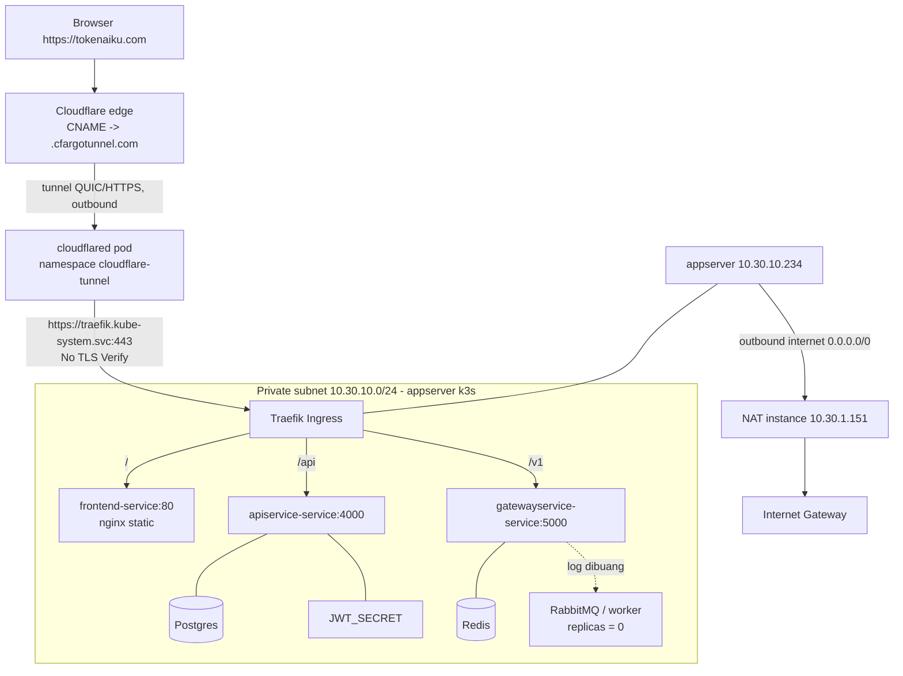
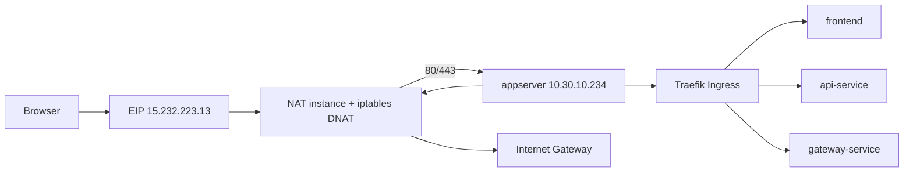

# Arsitektur Infrastruktur

Akses publik memakai **Cloudflare Tunnel**. ALB/ACM dan cert-manager tidak
dipakai. Appserver tetap di private subnet tanpa public IP.

---

## 1. Skema yang dipakai: Cloudflare Tunnel

`cloudflared` berjalan sebagai pod di k3s. Dialah yang membuka koneksi keluar
ke Cloudflare, jadi tidak ada port inbound yang harus dibuka di appserver.



### Kenapa cocok

| Aspek | Keterangan |
|---|---|
| Public IP appserver | Tidak perlu |
| Port inbound 80/443 | Tidak perlu |
| TLS browser | Dipegang Cloudflare (sertifikat valid) |
| TLS origin | Self-signed Traefik, verifikasi dimatikan di tunnel |
| DNS | CNAME otomatis ke `<tunnel-id>.cfargotunnel.com` |
| Biaya tunnel | Gratis |

### Ingress tetap dipakai

| Ingress | Entry point | Path | Backend |
|---|---|---|---|
| `http-redirect-ingress` | `web` (:80) | `/` | 301 → HTTPS (internal) |
| `frontendservice-ingress` | `websecure` (:443) | `/` | `frontend-service:80` |
| `apiservice-ingress` | `websecure` (:443) | `/api` | `apiservice-service:4000` |
| `gatewayservice-ingress` | `websecure` (:443) | `/v1` | `gatewayservice-service:5000` |

### Manifest terkait

- `kubernetes/cloudflare-tunnel/namespace.yaml`
- `kubernetes/cloudflare-tunnel/deployment.yaml`
- `kubernetes/cloudflare-tunnel/README.md` — langkah lengkap (token, route, verifikasi)

---

## 2. Jalur lama (NAT + DNAT, sekarang opsional)

Ini yang dipakai sebelum tunnel. Masih aktif di AWS, tapi tidak lagi menjadi
jalur utama.



Routing AWS:

| Route table | Subnet | Default route |
|---|---|---|
| `rtb-0ac3992a5e226acd0` | public `10.30.1.0/24` | `0.0.0.0/0` → Internet Gateway |
| `rtb-005a29ba517a55d30` | private `10.30.10.0/24` | `0.0.0.0/0` → NAT instance |

Security group:

| SG | Inbound |
|---|---|
| NAT `sg-07cb13f76a947e667` | 80, 443 dari `0.0.0.0/0`; all dari `10.30.10.0/24` |
| App `sg-0489d4203a1742f30` | 80, 443 dari SG NAT |

Kalau tunnel sudah terbukti stabil, DNAT dan rule inbound SG di atas bisa
dicabut supaya EIP tidak lagi menerima traffic publik. NAT instance tetap
diperlukan untuk **outbound** internet dari private subnet.

---

## 3. Catatan penting

- `apiservice-secret` berisi `JWT_SECRET`, `POSTGRES_USER`,
  `POSTGRES_PASSWORD`, `POSTGRES_DB`, `tls.crt`, dan `tls.key`.
  Jangan ditimpa oleh tool sertifikat lain.
- RabbitMQ dan worker sengaja `replicas: 0` supaya t3.small (2GB) cukup.
- Token Cloudflare disimpan sebagai Kubernetes Secret, **jangan** dimasukkan
  ke Git.
- Jika tunnel putus, cek:
  ```bash
  kubectl-ms -n cloudflare-tunnel logs deploy/cloudflared --tail=50
  kubectl-ms -n cloudflare-tunnel get pods
  ```
